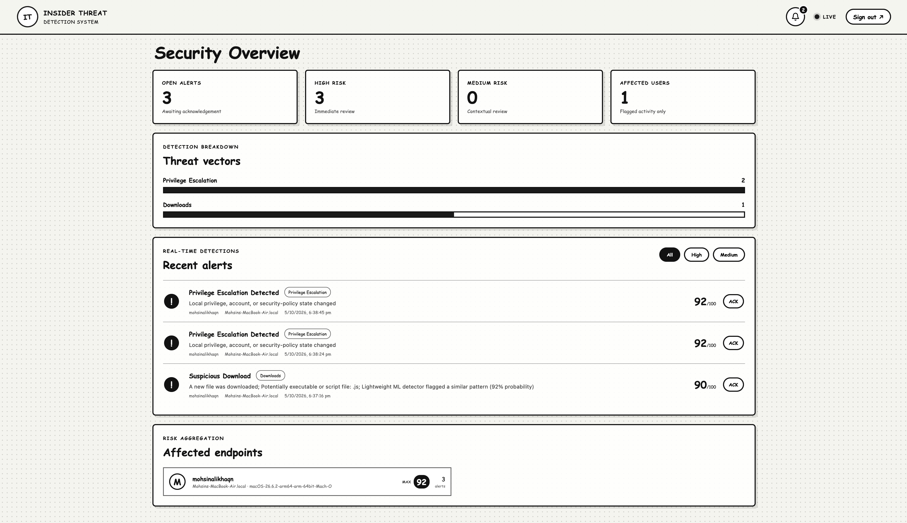
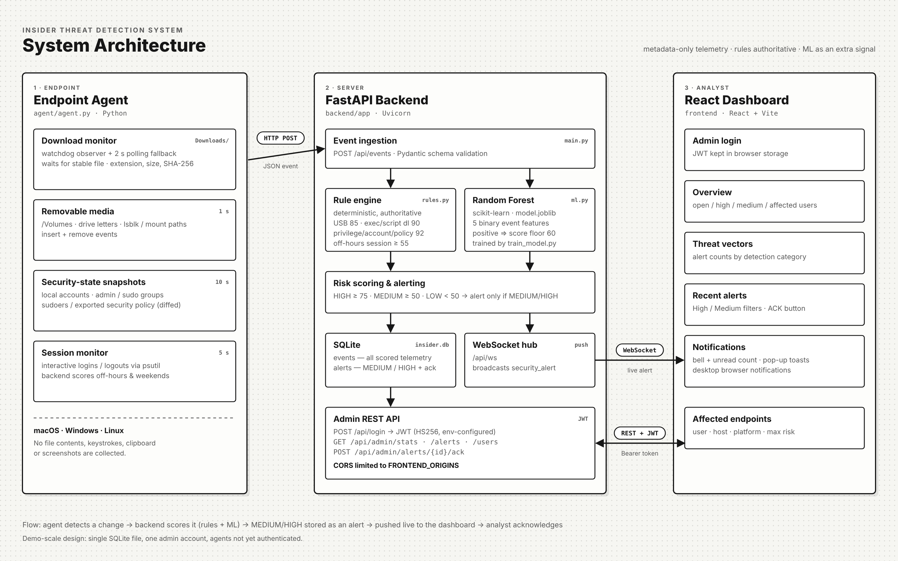

<div align="center">

# Insider Threat Detection System

**Cross-platform endpoint monitoring that flags risky insider activity in real time — removable media, suspicious downloads, privilege and account changes, and off-hours sessions — and streams scored alerts to a live SOC-style dashboard.**




</div>

---

## Contents

- [Overview](#overview)
- [What it detects](#what-it-detects)
- [Architecture](#architecture)
- [Tech stack](#tech-stack)
- [Project structure](#project-structure)
- [Getting started](#getting-started)
- [Configuration](#configuration)
- [Testing the detections](#testing-the-detections)
- [Risk scoring](#risk-scoring)
- [API reference](#api-reference)
- [Privacy](#privacy)
- [Limitations](#limitations)
- [Troubleshooting](#troubleshooting)

---

## Overview

The system has three parts:

| Component | Role |
|---|---|
| **Endpoint agent** (`agent/`) | Lightweight Python process on each monitored machine. Watches for security-relevant changes and sends metadata-only events to the backend. |
| **Backend** (`backend/`) | FastAPI service that scores every event with a deterministic rule engine plus a Random Forest signal, stores results in SQLite, and pushes MEDIUM/HIGH alerts live over WebSocket. |
| **Dashboard** (`frontend/`) | React admin console showing open alerts, threat vectors, recent alerts (with filters and acknowledgement), affected endpoints and live notifications. |

The dashboard intentionally shows **flagged activity and aggregated risk only**, not raw telemetry.

## What it detects

| Detection | How the agent sees it | Check interval |
|---|---|---|
| **Removable media** | New mount under `/Volumes` (macOS), new partition (Windows), `lsblk` removable flag or `/media`, `/mnt`, `/run/media` (Linux) | 1 s |
| **Suspicious downloads** | `watchdog` observer on `~/Downloads` + polling fallback; waits until the file is fully written, then records name, extension, size and SHA-256 | real-time + 2 s |
| **Privilege escalation** | Change in admin group membership (`admin` on macOS, `sudo`/`wheel` on Linux, `Administrators` on Windows) | 10 s |
| **Account manipulation** | Change in the local account database (`/etc/passwd`, `/etc/group`, `net user`) | 10 s |
| **Security policy change** | Change in sudoers (macOS/Linux) or exported local security policy via `secedit` (Windows) | 10 s |
| **Off-hours sessions** | New interactive login (via `psutil`), scored higher between 22:00–06:00 and on weekends | 5 s |

Account, privilege and policy state is compared as **SHA-256 fingerprints** — the raw configuration never leaves the machine.

## Architecture



1. The **agent** detects a change and sends a JSON event to `POST /api/events`.
2. The **rule engine** assigns an authoritative score; the **Random Forest** acts as an extra signal that can raise the score to at least 60.
3. Events are classified **HIGH (≥ 75)**, **MEDIUM (≥ 50)** or **LOW**. Every event is stored; MEDIUM and HIGH become **alerts**.
4. New alerts are **broadcast over WebSocket** to every open dashboard, which raises an in-app notification, a pop-up toast and a browser notification.
5. The analyst reviews and **acknowledges** alerts through the JWT-protected admin API.

## Tech stack

| Layer | Technologies |
|---|---|
| Agent | Python, `watchdog`, `psutil`, `requests` |
| Backend | FastAPI, Uvicorn, Pydantic, python-jose (JWT), SQLite |
| ML | scikit-learn `RandomForestClassifier`, joblib |
| Frontend | React 18, Vite 5, WebSocket, Notifications API |

## Project structure

```text
.
├── agent/
│   ├── agent.py            # Endpoint agent (downloads, USB, security state, sessions)
│   └── requirements.txt
├── backend/
│   ├── app/
│   │   ├── main.py         # FastAPI app: ingestion, scoring, alerts, auth, WebSocket
│   │   ├── rules.py        # Deterministic rule engine
│   │   ├── ml.py           # Random Forest inference
│   │   └── train_model.py  # Trains and saves model.joblib
│   └── requirements.txt
├── frontend/
│   ├── src/
│   │   ├── main.jsx        # Login + dashboard + notifications
│   │   └── style.css       # Paper-style theme
│   ├── index.html
│   └── package.json
└── docs/
    ├── architecture.png
    └── dashboard.png
```

## Getting started

### Prerequisites

| Tool | Version | Check with |
|---|---|---|
| Python | 3.10 or newer | `python3 --version` (Windows: `python --version`) |
| Node.js | 18 or newer (includes npm) | `node --version` |
| Git | any | `git --version` |

You will need **three terminals**: one each for the backend, the dashboard and the agent. Start them in that order.

### 1. Clone the repository

```bash
git clone https://github.com/rootmak404/ai-insider-threat-detection.git
cd ai-insider-threat-detection
```

### 2. Start the backend (terminal 1)

**macOS / Linux**

```bash
cd backend
python3 -m venv .venv
source .venv/bin/activate
pip install -r requirements.txt
python -m app.train_model          # creates app/model.joblib (one-time)
uvicorn app.main:app --reload --host 0.0.0.0 --port 8000
```

**Windows (PowerShell)**

```powershell
cd backend
python -m venv .venv
.venv\Scripts\Activate.ps1
pip install -r requirements.txt
python -m app.train_model
uvicorn app.main:app --reload --host 0.0.0.0 --port 8000
```

> If PowerShell blocks the activation script, run `Set-ExecutionPolicy -Scope CurrentUser RemoteSigned` once and try again.

Check it is running: open <http://127.0.0.1:8000/api/health> — you should see `{"status":"ok"}`. Interactive API docs are at <http://127.0.0.1:8000/docs>.

### 3. Start the dashboard (terminal 2)

```bash
cd frontend
npm install
npm run dev
```

Open <http://localhost:5173> and sign in with the demo account:

| Username | Password |
|---|---|
| `admin` | `admin123` |

Allow browser notifications when prompted if you want desktop alerts. The **LIVE** indicator in the top bar turns solid once the WebSocket connects.

### 4. Start the agent (terminal 3)

**macOS / Linux**

```bash
cd agent
python3 -m venv .venv
source .venv/bin/activate
pip install -r requirements.txt
python agent.py
```

**Windows (PowerShell)**

```powershell
cd agent
python -m venv .venv
.venv\Scripts\Activate.ps1
pip install -r requirements.txt
python agent.py
```

You should see:

```text
=== Insider Threat Endpoint Agent v4.2 ===
user=<you> host=<your-machine> agent=<agent-id> backend=http://127.0.0.1:8000
[downloads] monitoring /Users/<you>/Downloads
[volumes] monitoring removable/external volumes
[security] monitoring account, privilege and local policy state
[session] monitoring interactive sessions and off-hours activity
```

> **Permissions:** downloads, USB, account, admin-group and session monitoring work as a normal user. Security-policy monitoring needs elevated access: on Windows run the agent from an **Administrator** terminal (required by `secedit`); on macOS/Linux `/etc/sudoers` is readable only by root, so policy changes are not seen when the agent runs as a normal user.

### 5. Monitoring other machines (optional)

Run the backend once, then run the agent on each endpoint, pointing it at the backend's LAN address:

```bash
# macOS / Linux
BACKEND_URL=http://192.168.1.50:8000 python agent.py
```

```powershell
# Windows
$env:BACKEND_URL="http://192.168.1.50:8000"; python agent.py
```

If you open the dashboard from another machine, start it with `VITE_API_URL=http://<backend-ip>:8000 npm run dev -- --host` and add that dashboard address to `FRONTEND_ORIGINS` on the backend.

## Configuration

All settings are environment variables. Defaults are for local development only.

**Backend**

| Variable | Default | Purpose |
|---|---|---|
| `ADMIN_USERNAME` | `admin` | Dashboard login username |
| `ADMIN_PASSWORD` | `admin123` | Dashboard login password — **change it** |
| `JWT_SECRET` | `CHANGE_ME_IN_PRODUCTION` | Signing key for admin tokens (valid 12 h) — **change it** |
| `FRONTEND_ORIGINS` | `http://localhost:5173,http://127.0.0.1:5173` | Comma-separated origins allowed to call the API from a browser (CORS) |
| `DB_PATH` | `backend/app/insider.db` | SQLite database location |

**Agent**

| Variable | Default | Purpose |
|---|---|---|
| `BACKEND_URL` | `http://127.0.0.1:8000` | Backend address |
| `AGENT_ID` | `<hostname>-<os>` | Identifier shown with each event |

**Frontend**

| Variable | Default | Purpose |
|---|---|---|
| `VITE_API_URL` | `http://127.0.0.1:8000` | Backend address used by the dashboard |

Example (macOS / Linux):

```bash
export ADMIN_PASSWORD='a-strong-password'
export JWT_SECRET="$(python3 -c 'import secrets; print(secrets.token_hex(32))')"
uvicorn app.main:app --host 0.0.0.0 --port 8000
```

## Testing the detections

Use a lab VM or a machine you own. Each test should produce an alert on the dashboard within a few seconds.

| Detection | Safe way to trigger it | Expected |
|---|---|---|
| Suspicious download | Create a script file in Downloads: `echo "echo hello" > ~/Downloads/test.sh` (Windows: `Set-Content $HOME\Downloads\test.bat "echo hello"`) | HIGH · 90 |
| Removable media | Plug in a USB drive | HIGH · 85 |
| Account manipulation | Create a temporary local user, then delete it | HIGH · 92 |
| Privilege escalation | Add a test user to the admin / sudo / Administrators group | HIGH · 92 |
| Security policy change | Edit sudoers with `visudo` (agent running as root) or change a local policy (Windows, admin terminal) | HIGH · 92 |
| Off-hours session | Log in between 22:00–06:00 or on a weekend (or change a VM's clock) | MEDIUM · 55+ |

**Without the agent**, you can send a test event straight to the backend:

```bash
curl -X POST http://127.0.0.1:8000/api/events \
  -H "Content-Type: application/json" \
  -d '{"event_type":"file_downloaded","username":"demo","hostname":"LAB-PC-01","platform":"Linux","agent_id":"lab-01","filename":"setup.exe","extension":".exe"}'
```

To reset all data, stop the backend and delete `backend/app/insider.db`.

## Risk scoring

| Rule | Base score |
|---|---|
| Removable volume inserted | 85 |
| Download with executable/script extension (`.exe`, `.ps1`, `.sh`, `.dmg`, `.js`, …) | 90 |
| Any other download | 35 (55 if larger than 250 MB) |
| Account, privilege or security-policy change | 92 |
| Interactive login | 20 |
| Login during off-hours / weekend | at least 55 |
| Login on a host whose name suggests a critical system (`server`, `dc`, `prod`, `finance`, …) | at least 85 |
| Random Forest flags the event | raised to at least 60 |

| Level | Score | Result |
|---|---|---|
| HIGH | ≥ 75 | Stored, alerted, pushed live |
| MEDIUM | 50 – 74 | Stored, alerted, pushed live |
| LOW | < 50 | Stored only |

## API reference

| Method | Endpoint | Auth | Description |
|---|---|---|---|
| `GET` | `/api/health` | — | Health check |
| `POST` | `/api/events` | — | Ingest an agent event; returns score, level and explanation |
| `POST` | `/api/login` | — | Exchange admin credentials for a JWT |
| `GET` | `/api/admin/stats` | JWT | Open, high, medium and affected-user counts |
| `GET` | `/api/admin/alerts` | JWT | Up to 200 alerts, unacknowledged and highest-risk first |
| `GET` | `/api/admin/users` | JWT | Per-endpoint alert count and max / average risk |
| `POST` | `/api/admin/alerts/{id}/ack` | JWT | Acknowledge an alert |
| `WS` | `/api/ws` | — | Live `security_alert` push channel |

Send the token as `Authorization: Bearer <token>`.

## Privacy

The agent collects **metadata only**: file names, extensions, sizes and hashes for new downloads; mount paths for removable media; usernames and session start/stop; and hash fingerprints of account, group and policy state. It does **not** read file contents, log keystrokes, capture the clipboard or take screenshots.

## Limitations

This is a portfolio / lab project, not a replacement for a commercial EDR. Known gaps:

- **Agents are not authenticated** — anyone who can reach `/api/events` can submit events.
- **The WebSocket channel is not authenticated** — anyone who can reach the backend can receive live alerts.
- **Single admin account** defined through environment variables; no user management or roles.
- **Traffic is plain HTTP** by default; put the backend behind TLS for any real deployment.
- **The ML model is a demonstration** trained on a small synthetic dataset; the rule engine is the authoritative detector.
- **State snapshots, not native audit logs** — the agent does not consume Windows Event Log, macOS Endpoint Security or Linux auditd, so it sees *that* something changed, not *who* changed it.
- **SQLite** is suitable for a handful of endpoints, not a large fleet.

## Troubleshooting

| Problem | Fix |
|---|---|
| Dashboard says **Backend unavailable** at login | Make sure the backend is running on port 8000 and `VITE_API_URL` points to it. |
| Browser console shows a **CORS** error | Add the exact dashboard address (scheme, host and port) to `FRONTEND_ORIGINS` and restart the backend. |
| Indicator stays on **RECONNECTING** | The WebSocket to `/api/ws` cannot connect — check the backend is reachable from the browser. Refresh after restarting the backend. |
| Agent prints `[backend] ... Connection refused` | Backend is not running or `BACKEND_URL` is wrong. |
| No ML reason in alert explanations | Run `python -m app.train_model` in `backend/` to create `model.joblib`. |
| Logged out unexpectedly | Admin tokens expire after 12 hours — sign in again. |
| No browser notifications | Allow notifications for `localhost:5173` in your browser's site settings. |

---

<div align="center">

Built by **[rootmak404](https://github.com/rootmak404)** · Final-year B.E. Computer Engineering (Cybersecurity Honours), University of Mumbai

</div>
